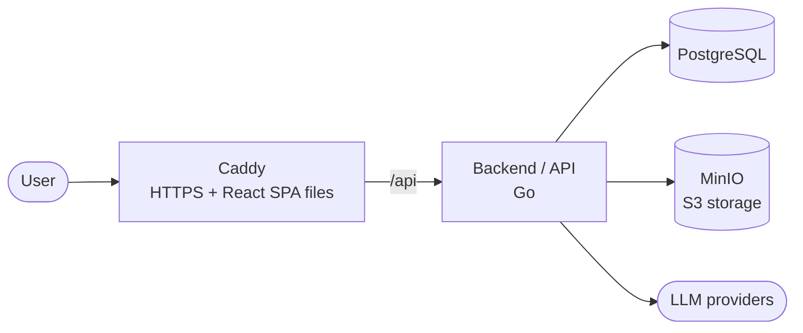

<!-- Main README. Keep README.pt-BR.md in sync with this file. -->

**English** | [Português](README.pt-BR.md)

# My Software Factory Manager

Client and project manager: a centralized platform for managing clients, projects and software development requests.

> **Status:** early definition. There is no code yet; sections marked _TBD_ will be filled in as the project evolves.

## Contents

- [About](#about)
- [Architecture](#architecture)
- [Tech stack](#tech-stack)
- [Build and deploy](#build-and-deploy)
- [Backup and maintenance](#backup-and-maintenance)
- [Documentation](#documentation)
- [License](#license)

## About

### Goal

The goal is to build a centralized platform for managing clients, projects and software development requests, serving as the operational hub of a software consultancy.

The idea is to have a single environment for managing the full lifecycle of a client and their projects, from first contact and requirements gathering through delivery, validation and maintenance of the solutions.

More than a simple task manager, the system should work as a smart digital office, organizing the information, documents, communication, requests and activities of each project.

### Problem it solves

_TBD._

<!-- Describe the current pain: where client and project information lives today, what gets lost or duplicated, and who suffers from it. -->

## Architecture

### Overview

Decided so far (see the ADRs below):



Frontend and backend live in this single repository. Folders not yet in use hold only a `.gitkeep` placeholder, and the root configuration files are added when the first code arrives:

```
.
├── apps/
│   ├── api/          # Go backend and API
│   ├── web/          # the real React app
│   └── prototype/    # clickable prototype with fake data, disposable
├── packages/
│   └── ui/           # design system: style variables and components
├── deploy/           # Caddyfile and deployment files
├── docs/
│   ├── adr/          # architecture decisions
│   ├── agents/       # configuration for AI agents
│   └── design/       # analysis of the visual references
├── .scratch/         # local issues
├── compose.yaml
├── Taskfile.yml
└── pnpm-workspace.yaml
```

The three JavaScript packages (`apps/web`, `apps/prototype`, `packages/ui`) form a pnpm workspace run through Vite+. A root Taskfile coordinates Go and frontend tasks: dev, build, test and code generation. No separate monorepo orchestrator is used.

Screens are designed and approved in the prototype first, then rebuilt in the real app on the same design system.

The system is multilingual: English is the default, with Brazilian Portuguese and Spanish also supported, and each user chooses their language. Adding a language is a small code change with no database schema change.

<!-- Describe each component's responsibility and how they communicate. Update the diagram once the architecture is confirmed. -->

### Architecture decisions

Significant, hard-to-reverse decisions are recorded as ADRs (Architecture Decision Records) in `docs/adr/`, one file per decision. This README holds only the overview and the index below.

- [0001 - Go for the backend](docs/adr/0001-go-for-the-backend.md): Go over TypeScript and Rust, because agents write the code and the build loop must stay short
- [0002 - React SPA without a full-stack framework](docs/adr/0002-react-spa-without-a-full-stack-framework.md): Vite+ and TanStack Router behind Caddy, no Next.js or TanStack Start
- [0003 - OpenAPI contract generated from Go](docs/adr/0003-openapi-contract-generated-from-go.md): Go types are the source of truth for the REST API, via Huma
- [0004 - LLM providers and agents over HTTP](docs/adr/0004-llm-providers-and-agents-over-http.md): one internal interface for providers; agents are separate services that act only through the API
- [0005 - Multilingual from the start](docs/adr/0005-multilingual-from-the-start.md): English, Brazilian Portuguese and Spanish; the frontend translates API error codes; configuration content has a version per language, free text is translated on demand
- [0006 - Design system proven in a disposable prototype](docs/adr/0006-design-system-proven-in-a-disposable-prototype.md): shadcn/ui in `packages/ui`, shared by the product and a clickable prototype whose approved screens are rebuilt, not moved
- [0007 - Backend organized by domain area](docs/adr/0007-backend-organized-by-domain-area.md): one package tree per domain area with dependencies pointing inward, a use case for every operation, selective tactical DDD and part of object calisthenics

## Tech stack

| Technology | Role in the project |
| --- | --- |
| [Go](https://go.dev/) | Backend and API |
| [Huma](https://huma.rocks/) | HTTP framework that generates the OpenAPI spec from Go types |
| [React](https://react.dev/) | Web frontend (single-page app) |
| [Vite+](https://viteplus.dev/) | Frontend toolchain behind one CLI (`vp`): dev server and build (Vite, Rolldown), tests (Vitest), lint (Oxlint), format (Oxfmt), plus the Node.js runtime and package manager |
| [TanStack Router](https://tanstack.com/router) | Typed client-side routing |
| [react-i18next](https://react.i18next.com/) | Interface translations (English, Brazilian Portuguese, Spanish) |
| [shadcn/ui](https://ui.shadcn.com/) | Base of the design system: component code copied into `packages/ui` |
| [Tailwind CSS](https://tailwindcss.com/) | Styling and the design system's style variables (light and dark themes) |
| [PostgreSQL](https://www.postgresql.org/) | Relational database |
| [MinIO](https://min.io/) | S3-compatible object storage (documents and files) |
| [Caddy](https://caddyserver.com/) | HTTPS, static frontend files and reverse proxy to the API |
| [Docker](https://www.docker.com/) | Packaging and running the services in containers (Docker Compose) |
| [Task](https://taskfile.dev/) | Task runner for the repository (dev, build, test, code generation) |
| [pnpm](https://pnpm.io/) | Frontend package manager, installed and run through Vite+ |

<!-- Add new technologies to this table as they are adopted. -->

## Build and deploy

### Prerequisites

| Tool | Minimum version |
| --- | --- |
| Docker | _TBD_ |
| Go | _TBD_ |
| Vite+ (manages Node.js and pnpm) | _TBD_ |
| Task | _TBD_ |

### Configuration

_TBD._

<!-- List the environment variables (PostgreSQL connection, MinIO credentials and buckets, etc.) and keep a versioned `.env.example` with no real secrets. -->

### Local development

_TBD._

<!-- Commands to bring up the local environment from scratch: clone, configure, start the services and open the app. -->

### Build

_TBD._

<!-- How to produce the production artifacts: backend binary, frontend bundle, Docker images. -->

### Deploy

_TBD._

<!-- Where the application runs, how to ship a new version and how to roll back to the previous one. -->

## Backup and maintenance

### Backup

| What | How | Frequency | Retention |
| --- | --- | --- | --- |
| Database (PostgreSQL) | _TBD_ | _TBD_ | _TBD_ |
| Files (MinIO) | _TBD_ | _TBD_ | _TBD_ |

<!-- Also state where backups are stored, preferably off the application server. -->

### Restore

_TBD._

<!-- Step by step to restore the database and files from a backup. Test restores periodically: a backup that has never been restored is not a guarantee. -->

### Maintenance

_TBD._

<!-- Recurring routines: database migrations, dependency and Docker image updates, credential rotation, monitoring and logs. -->

## Documentation

- `docs/adr/`: architecture decisions (ADRs).
- `GLOSSARY.md`: glossary of domain terms.
- [`CODING_STANDARDS.md`](CODING_STANDARDS.md): how code is written, for agents and for review.
- [`docs/design/`](docs/design/): analysis of the visual references behind the design system.
- [`docs/agents/`](docs/agents/): configuration used by AI agents in this repository.

`docs/adr/` and `GLOSSARY.md` are created as the domain and the architecture are defined.

## License

_TBD._
