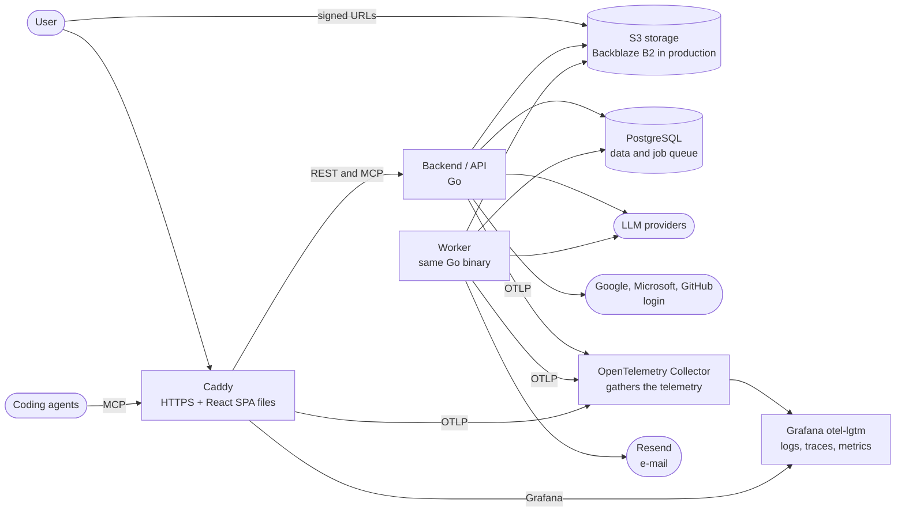

<!-- Main README. Keep README.pt-BR.md in sync with this file. -->

**English** | [Português](README.pt-BR.md)

# My Software Factory Manager

Client and project manager: a centralized platform for managing clients, projects and software development requests.

> **Status:** early definition. There is no code yet; sections marked _TBD_ will be filled in as the project evolves.

## Contents

- [About](#about)
- [Architecture](#architecture)
- [Tech stack](#tech-stack)
- [Build and deploy](#build-and-deploy)
- [Backup and maintenance](#backup-and-maintenance)
- [Documentation](#documentation)
- [License](#license)

## About

### Goal

The goal is to build a centralized platform for managing clients, projects and software development requests, serving as the operational hub of a software consultancy.

The idea is to have a single environment for managing the full lifecycle of a client and their projects, from first contact and requirements gathering through delivery, validation and maintenance of the solutions.

More than a simple task manager, the system should work as a smart digital office, organizing the information, documents, communication, requests and activities of each project.

### Problem it solves

_TBD._

<!-- Describe the current pain: where client and project information lives today, what gets lost or duplicated, and who suffers from it. -->

## Architecture

### Overview

Decided so far (see the ADRs below):



The worker runs the background jobs that the API saves in PostgreSQL: sending e-mail, processing files, calls to LLM providers that nobody waits for on a screen. The browser sends and fetches files straight to and from the storage, with signed URLs issued by the API.

In production the files are in Backblaze B2. In development and staging they are in Garage, behind a host name of Caddy.

Telemetry goes through the collector: traces and metrics from the API, the worker and Caddy, the output of every container, and the metrics of the server, PostgreSQL and the storage. It forwards everything to Grafana otel-lgtm, which keeps it for 30 days and sends the alerts by e-mail. Grafana has a host name of its own behind Caddy, with a login through GitHub. The two telemetry containers run in development only for now: production gets them when someone other than the maintainer uses the system, and until then a hosted monitor outside the server watches it.

The system runs in three environments: development on the maintainer's machine, staging on a server created for one pull request and destroyed afterwards, and production on one server that is always on.

Frontend and backend live in this single repository. Folders not yet in use hold only a `.gitkeep` placeholder, and the root configuration files are added when the first code arrives:

```
.
├── apps/
│   ├── api/          # Go backend and API
│   ├── web/          # the real React app
│   └── prototype/    # clickable prototype with fake data, disposable
├── packages/
│   └── ui/           # design system: style variables and components
├── deploy/           # Caddyfile, Compose files of the servers, cloud-init
├── .github/          # pipeline workflows
├── docs/
│   ├── adr/          # architecture decisions
│   ├── agents/       # configuration for AI agents
│   └── design/       # analysis of the visual references
├── .scratch/         # local issues
├── compose.yaml      # development
├── Taskfile.yml
└── pnpm-workspace.yaml
```

The three JavaScript packages (`apps/web`, `apps/prototype`, `packages/ui`) form a pnpm workspace run through Vite+. A root Taskfile coordinates Go and frontend tasks: dev, build, test and code generation. No separate monorepo orchestrator is used.

Screens are designed and approved in the prototype first, then rebuilt in the real app on the same design system.

The system is multilingual: English is the default, with Brazilian Portuguese and Spanish also supported, and each user chooses their language. Adding a language is a small code change with no database schema change.

<!-- Describe each component's responsibility and how they communicate. Update the diagram once the architecture is confirmed. -->

### Architecture decisions

Significant, hard-to-reverse decisions are recorded as ADRs (Architecture Decision Records) in `docs/adr/`, one file per decision. This README holds only the overview and the index below.

- [0001 - Go for the backend](docs/adr/0001-go-for-the-backend.md): Go over TypeScript and Rust, because agents write the code and the build loop must stay short
- [0002 - React SPA without a full-stack framework](docs/adr/0002-react-spa-without-a-full-stack-framework.md): Vite+ and TanStack Router behind Caddy, no Next.js or TanStack Start
- [0003 - OpenAPI contract generated from Go](docs/adr/0003-openapi-contract-generated-from-go.md): Go types are the source of truth for the REST API, via Huma
- [0004 - LLM providers and agents over HTTP](docs/adr/0004-llm-providers-and-agents-over-http.md): one internal interface for providers; agents are separate services that act only through the API
- [0005 - Multilingual from the start](docs/adr/0005-multilingual-from-the-start.md): English, Brazilian Portuguese and Spanish; the frontend translates API error codes; configuration content has a version per language, free text is translated on demand
- [0006 - Design system proven in a disposable prototype](docs/adr/0006-design-system-proven-in-a-disposable-prototype.md): shadcn/ui in `packages/ui`, shared by the product and a clickable prototype whose approved screens are rebuilt, not moved
- [0007 - Backend organized by domain area](docs/adr/0007-backend-organized-by-domain-area.md): one package tree per domain area with dependencies pointing inward, a use case for every operation, selective tactical DDD and part of object calisthenics
- [0008 - Use cases served by several inbound adapters](docs/adr/0008-use-cases-served-by-several-inbound-adapters.md): a complete REST API and an MCP server with a chosen set of tools, both in the Go backend; access tokens with scopes; GraphQL, gRPC and WebSocket deferred
- [0009 - REST API conventions](docs/adr/0009-rest-api-conventions.md): snake_case, named operations with no PATCH, strict input, problem+json errors, cursor pagination, no versioning while every consumer ships with the backend
- [0010 - Sequential identifiers exposed through Sqids](docs/adr/0010-sequential-identifiers-exposed-through-sqids.md): integers inside, a type prefix plus a Sqids encoding outside (`prj_Xk9fQ2mB`), with alphabets fixed in the code
- [0011 - Login through external providers or a login code](docs/adr/0011-login-through-external-providers-with-a-server-side-session.md): Google, Microsoft and GitHub, or a six-digit code sent by e-mail; a server-side session behind an opaque cookie, registered users only
- [0012 - OpenTelemetry and a separate audit log](docs/adr/0012-opentelemetry-for-observability-and-a-separate-audit-log.md): traces and metrics sent through a collector to a Grafana container, logs read from the container output, alerts by e-mail; sensitive operations recorded in an append-only audit log
- [0013 - Frontend data in collections and cursor queries](docs/adr/0013-frontend-data-in-collections-and-cursor-queries.md): TanStack DB for bounded sets, TanStack Query with the API's cursor for the rest, Zustand for interface state only, a client and Zod schemas generated by orval, TanStack Form
- [0014 - Frontend organized by domain area](docs/adr/0014-frontend-organized-by-domain-area-and-tested-through-screens.md): one folder per domain area with a data module that alone calls the API; tests render whole screens in a real browser with a simulated API
- [0015 - Hand-written SQL checked by sqlc, and forward-only migrations](docs/adr/0015-hand-written-sql-checked-by-sqlc-and-forward-only-migrations.md): pgx and sqlc, goose migrations with no way back run as their own step, three database roles, PostgreSQL as the only data service with no cache and no connection pooler
- [0016 - Background jobs in PostgreSQL, run by a worker command](docs/adr/0016-background-jobs-in-postgresql-run-by-a-worker-command.md): River, a job saved in the transaction of its use case, a `worker` command of the same binary, few attempts and then a visible failure
- [0017 - Files in Garage, reached directly by the browser](docs/adr/0017-files-in-garage-reached-directly-by-the-browser.md): Garage in place of MinIO, only the S3 API through the AWS SDK for Go v2, uploads and downloads with short-lived signed URLs
- [0018 - Credential values encrypted by the API](docs/adr/0018-credential-values-encrypted-by-the-api.md): AES-256-GCM in the Go binary with a key from the deploy configuration, never in the database; a credential file is stored the same way
- [0019 - Three environments, with staging on a server created on demand](docs/adr/0019-three-environments-with-staging-on-a-server-created-on-demand.md): development on the machine, a staging server created for a labelled pull request and seeded on every publish, production on one Hetzner server; GitHub Actions publishes over SSH, with secrets in GitHub Environments
- [0020 - PostgreSQL backed up by pgBackRest, and production files in Backblaze B2](docs/adr/0020-postgresql-backed-up-by-pgbackrest-and-production-files-in-backblaze-b2.md): continuous encrypted backups at another provider with a monthly restore test, and production files in a versioned bucket; Garage stays in development and staging
- [0021 - A public repository under AGPLv3](docs/adr/0021-a-public-repository-under-agplv3.md): public on GitHub's free plan, with the rules that being public sets for commits and for the pipeline

## Tech stack

| Technology | Role in the project |
| --- | --- |
| [Go](https://go.dev/) | Backend and API |
| [Huma](https://huma.rocks/) | HTTP framework that generates the OpenAPI spec from Go types |
| [MCP Go SDK](https://github.com/modelcontextprotocol/go-sdk) | MCP server inside the backend, through which coding agents operate the system |
| [Sqids](https://sqids.org/go) | Short public identifiers encoded from the internal sequential ones |
| [SCS](https://github.com/alexedwards/scs) | Server-side sessions, stored in PostgreSQL |
| [env](https://github.com/caarlos0/env) | Reads the configuration from environment variables into one typed struct |
| [pgx](https://github.com/jackc/pgx) | PostgreSQL driver and the connection pool inside the API |
| [sqlc](https://sqlc.dev/) | Generates typed Go code from hand-written SQL |
| [goose](https://github.com/pressly/goose) | Applies the database migrations, forward only |
| [pgtestdb](https://github.com/peterldowns/pgtestdb) | Gives each database test its own temporary database |
| [River](https://riverqueue.com/) | Background jobs stored in PostgreSQL and run by the `worker` command, with a web panel |
| [AWS SDK for Go v2](https://github.com/aws/aws-sdk-go-v2) | Client for the S3 storage; signs the upload and download URLs |
| [go-mail](https://github.com/wneessen/go-mail) | Sends e-mail over SMTP in development and tests |
| [Resend](https://resend.com/) | Sends the e-mail in production and reports bounces |
| [Mailpit](https://mailpit.axllent.org/) | Container that captures the e-mail sent in development and tests |
| [OpenTelemetry](https://opentelemetry.io/) | Traces and metrics from the backend |
| [OpenTelemetry Collector](https://opentelemetry.io/docs/collector/) | Container that gathers traces, metrics and logs from every service and from the server |
| [Grafana otel-lgtm](https://grafana.com/docs/opentelemetry/docker-lgtm/) | One container that stores and shows the telemetry, and sends the alerts |
| [vacuum](https://quobix.com/vacuum/) and [oasdiff](https://github.com/oasdiff/oasdiff) | Lint of the API conventions and report of breaking changes on the OpenAPI spec |
| [React](https://react.dev/) | Web frontend (single-page app) |
| [Vite+](https://viteplus.dev/) | Frontend toolchain behind one CLI (`vp`): dev server and build (Vite, Rolldown), tests (Vitest), lint (Oxlint), format (Oxfmt), plus the Node.js runtime and package manager |
| [TanStack Router](https://tanstack.com/router) | Typed client-side routing; filters and pagination live in the URL |
| [TanStack DB](https://tanstack.com/db) and [TanStack Query](https://tanstack.com/query) | Data from the API in the browser: collections for small sets, cursor queries for the rest |
| [TanStack Form](https://tanstack.com/form) and [Zod](https://zod.dev/) | Forms, validated with schemas generated from the OpenAPI spec |
| [Zustand](https://github.com/pmndrs/zustand) | Interface state shared between screens (theme, panels) |
| [orval](https://orval.dev/) | Generates the TypeScript client, the Zod schemas and simulated responses from the OpenAPI spec |
| [React Compiler](https://react.dev/learn/react-compiler) | Automatic memoization of components at build time |
| [Playwright](https://playwright.dev/) and [MSW](https://mswjs.io/) | Screen tests in a real browser with a simulated API (through Vitest), and end-to-end tests |
| [Knip](https://knip.dev/) | Finds unused files, exports and dependencies |
| [Chrome DevTools MCP](https://github.com/ChromeDevTools/chrome-devtools-mcp) | Lets coding agents investigate performance in a real Chrome |
| [react-i18next](https://react.i18next.com/) | Interface translations (English, Brazilian Portuguese, Spanish) |
| [shadcn/ui](https://ui.shadcn.com/) | Base of the design system: component code copied into `packages/ui`, on [Base UI](https://base-ui.com/) primitives |
| [Tailwind CSS](https://tailwindcss.com/) | Styling and the design system's style variables (light and dark themes) |
| [PostgreSQL](https://www.postgresql.org/) | Relational database (version 18) and the only data service |
| [Garage](https://garagehq.deuxfleurs.fr/) | S3-compatible object storage (documents and files) in development and staging |
| [Backblaze B2](https://www.backblaze.com/cloud-storage) | S3-compatible object storage in production: the files and the database backups |
| [pgBackRest](https://pgbackrest.org/) | Continuous, encrypted backup of PostgreSQL, restorable to a point in time |
| [Dex](https://dexidp.io/) | Identity container behind the local login provider, in development and tests |
| [Hetzner Cloud](https://www.hetzner.com/cloud) | The production server, and the staging server created on demand |
| [GitHub Actions](https://docs.github.com/actions) | The pipeline: checks on every pull request, publishing, scheduled tests |
| [GitHub CLI](https://cli.github.com/) | How agents reach GitHub: pull requests, runs, secrets |
| [Caddy](https://caddyserver.com/) | HTTPS, static frontend files, reverse proxy to the API, security headers and the limit on the login code |
| [Docker](https://www.docker.com/) | Packaging and running the services in containers (Docker Compose) |
| [Task](https://taskfile.dev/) | Task runner for the repository (dev, build, test, code generation) |
| [pnpm](https://pnpm.io/) | Frontend package manager, installed and run through Vite+ |

<!-- Add new technologies to this table as they are adopted. -->

## Build and deploy

### Prerequisites

| Tool | Minimum version |
| --- | --- |
| Docker | _TBD_ |
| Go | _TBD_ |
| Vite+ (manages Node.js and pnpm) | _TBD_ |
| Task | _TBD_ |
| GitHub CLI | _TBD_ |

### Configuration

_TBD._

<!-- List the environment variables (PostgreSQL connection, storage credentials and bucket, e-mail server, etc.) and keep a versioned `.env.example` with no real secrets. -->

### Local development

_TBD._

<!-- Commands to bring up the local environment from scratch: clone, configure, start the services and open the app. -->

### Build

_TBD._

<!-- How to produce the production artifacts: backend binary, frontend bundle, Docker images. -->

### Deploy

Every change reaches `main` through a pull request, and a merge into `main` is published to production once the pipeline passes. GitHub Actions builds the images, pushes them to the GitHub container registry and logs in to the server over SSH to pull them and restart the Compose services. The secrets of each environment are in GitHub Environments, and the publish writes them to a variables file on the server (see [ADR-0019](docs/adr/0019-three-environments-with-staging-on-a-server-created-on-demand.md)).

To look at a branch before merging it, give its pull request the `staging` label. A server is created with the branch on it, a fresh database and the seed data. It is destroyed when the label is removed or the pull request closes, and never lives longer than 24 hours.

Going back to an earlier version is a manual workflow that publishes an earlier commit of `main`.

A deploy restarts the single API instance. The API finishes the requests in flight before it exits (see Shutdown in [`CODING_STANDARDS.md`](CODING_STANDARDS.md)), so the Compose file gives it a `stop_grace_period` of 30 seconds, and Caddy holds new requests for up to 30 seconds (`lb_try_duration`) until the new instance accepts connections.

Before the API starts, a one-shot Compose service applies the pending database migrations, and the API starts only when it succeeds. When a migration is pending, the deploy takes a `pg_dump` first, because migrations have no way back (see [ADR-0015](docs/adr/0015-hand-written-sql-checked-by-sqlc-and-forward-only-migrations.md)).

The worker is a second service of the same image, started with the `worker` command. On a deploy it stops taking jobs and gives the running ones time to finish. A job that is cut runs again later (see [ADR-0016](docs/adr/0016-background-jobs-in-postgresql-run-by-a-worker-command.md)).

The commands are _TBD_, written with the first code.

## Backup and maintenance

### Backup

| What | How | Frequency | Retention |
| --- | --- | --- | --- |
| Database (PostgreSQL) | pgBackRest, encrypted, to a bucket at Backblaze B2 | Write-ahead log continuously, a differential backup every day, a full one every week | 30 days, restorable to any moment |
| Database, before a migration | `pg_dump` taken by the publish, kept on the server | Each publish with a pending migration | The last three |
| Files (Backblaze B2) | Object versioning on the production bucket | Every change | An old version for 30 days |

The backups are at a provider other than the one of the server. The key that encrypts credential values and the passphrase of the backups are never stored with them: they are secrets of the GitHub Environment, with a copy in the maintainer's password manager. A monitor outside the server warns when a backup does not report (see [ADR-0020](docs/adr/0020-postgresql-backed-up-by-pgbackrest-and-production-files-in-backblaze-b2.md)).

### Restore

Every month a scheduled workflow creates a server, restores the latest backup there, checks it and destroys the server.

The steps to restore by hand are _TBD_, written with the backup routine.

<!-- Step by step to restore the database and files from a backup. -->

### Maintenance

- **Dependencies.** `task outdated` lists what has a newer release. Each update is its own pull request (see Versions in [`CODING_STANDARDS.md`](CODING_STANDARDS.md)).
- **Vulnerabilities.** A weekly workflow runs govulncheck, `pnpm audit` and Trivy on the images.
- **Logs.** In production, the output of the containers is read on the server.

The rest is _TBD._

<!-- Recurring routines still to describe: credential rotation, updating the servers. -->

## Documentation

- `docs/adr/`: architecture decisions (ADRs).
- `GLOSSARY.md`: glossary of domain terms.
- [`CODING_STANDARDS.md`](CODING_STANDARDS.md): how code is written, for agents and for review.
- [`docs/providers.md`](docs/providers.md): the outside services the system depends on, with the reason, the cost and what is configured at each.
- [`docs/design/`](docs/design/): analysis of the visual references behind the design system.
- [`docs/agents/`](docs/agents/): configuration used by AI agents in this repository.

`docs/adr/` and `GLOSSARY.md` are created as the domain and the architecture are defined.

## License

[GNU Affero General Public License, version 3](LICENSE). See [ADR-0021](docs/adr/0021-a-public-repository-under-agplv3.md).
