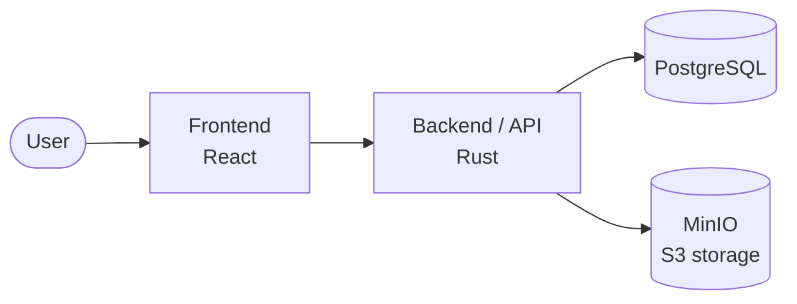

<!-- Main README. Keep README.pt-BR.md in sync with this file. -->

**English** | [Português](README.pt-BR.md)

# My Software Factory Manager

Client and project manager: a centralized platform for managing clients, projects and software development requests.

> **Status:** early definition. There is no code yet; sections marked _TBD_ will be filled in as the project evolves.

## Contents

- [About](#about)
- [Architecture](#architecture)
- [Tech stack](#tech-stack)
- [Build and deploy](#build-and-deploy)
- [Backup and maintenance](#backup-and-maintenance)
- [Documentation](#documentation)
- [License](#license)

## About

### Goal

The goal is to build a centralized platform for managing clients, projects and software development requests, serving as the operational hub of a software consultancy.

The idea is to have a single environment for managing the full lifecycle of a client and their projects, from first contact and requirements gathering through delivery, validation and maintenance of the solutions.

More than a simple task manager, the system should work as a smart digital office, organizing the information, documents, communication, requests and activities of each project.

### Problem it solves

_TBD._

<!-- Describe the current pain: where client and project information lives today, what gets lost or duplicated, and who suffers from it. -->

## Architecture

### Overview

Preliminary view, to be confirmed:

<!-- Describe each component's responsibility and how they communicate. Update the diagram once the architecture is confirmed. -->

### Architecture decisions

Significant, hard-to-reverse decisions are recorded as ADRs (Architecture Decision Records) in `docs/adr/`, one file per decision. This README holds only the overview and the index below.

_No decisions recorded yet._

<!-- One line per ADR, e.g.:
- [0001 - Title](docs/adr/0001-title.md): one-line summary
-->

## Tech stack

| Technology | Role in the project |
| --- | --- |
| [Rust](https://www.rust-lang.org/) | Backend and API |
| [React](https://react.dev/) | Web frontend |
| [PostgreSQL](https://www.postgresql.org/) | Relational database |
| [MinIO](https://min.io/) | S3-compatible object storage (documents and files) |
| [Docker](https://www.docker.com/) | Packaging and running the services in containers |

<!-- Add new technologies to this table as they are adopted. -->

## Build and deploy

### Prerequisites

| Tool | Minimum version |
| --- | --- |
| Docker | _TBD_ |
| Rust | _TBD_ |
| Node.js | _TBD_ |

### Configuration

_TBD._

<!-- List the environment variables (PostgreSQL connection, MinIO credentials and buckets, etc.) and keep a versioned `.env.example` with no real secrets. -->

### Local development

_TBD._

<!-- Commands to bring up the local environment from scratch: clone, configure, start the services and open the app. -->

### Build

_TBD._

<!-- How to produce the production artifacts: backend binary, frontend bundle, Docker images. -->

### Deploy

_TBD._

<!-- Where the application runs, how to ship a new version and how to roll back to the previous one. -->

## Backup and maintenance

### Backup

| What | How | Frequency | Retention |
| --- | --- | --- | --- |
| Database (PostgreSQL) | _TBD_ | _TBD_ | _TBD_ |
| Files (MinIO) | _TBD_ | _TBD_ | _TBD_ |

<!-- Also state where backups are stored, preferably off the application server. -->

### Restore

_TBD._

<!-- Step by step to restore the database and files from a backup. Test restores periodically: a backup that has never been restored is not a guarantee. -->

### Maintenance

_TBD._

<!-- Recurring routines: database migrations, dependency and Docker image updates, credential rotation, monitoring and logs. -->

## Documentation

- `docs/adr/`: architecture decisions (ADRs).
- `GLOSSARY.md`: glossary of domain terms.
- [`docs/agents/`](docs/agents/): configuration used by AI agents in this repository.

`docs/adr/` and `GLOSSARY.md` are created as the domain and the architecture are defined.

## License

_TBD._
