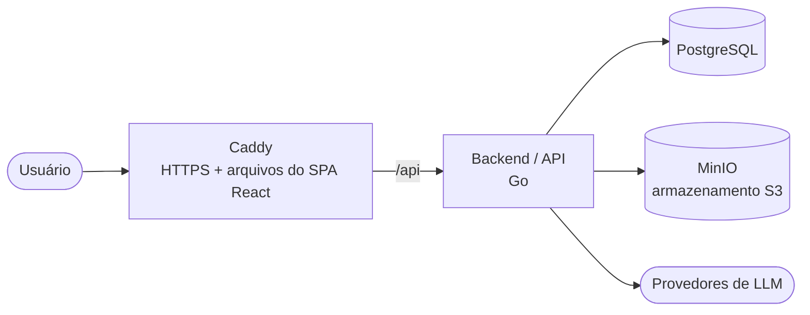

<!-- Versão em português. Mantenha este arquivo sincronizado com o README.md (versão principal). -->

[English](README.md) | **Português**

# My Software Factory Manager

Gerenciador de clientes e projetos: uma plataforma centralizada para gestão de clientes, projetos e demandas de desenvolvimento de software.

> **Status:** em fase de definição. Ainda não há código; as seções marcadas como _A definir_ serão preenchidas conforme o projeto avança.

## Sumário

- [Sobre o projeto](#sobre-o-projeto)
- [Arquitetura](#arquitetura)
- [Tecnologias](#tecnologias)
- [Build e deploy](#build-e-deploy)
- [Backup e manutenção](#backup-e-manutenção)
- [Documentação](#documentação)
- [Licença](#licença)

## Sobre o projeto

### Objetivo

O objetivo é criar uma plataforma centralizada para gestão de clientes, projetos e demandas de desenvolvimento de software, funcionando como o centro operacional de uma consultoria.

A ideia é ter um ambiente para administrar todo o ciclo de vida de um cliente e seus projetos, desde o primeiro contato e o levantamento de necessidades até a entrega, a validação e a manutenção das soluções.

Mais do que um simples gerenciador de tarefas, o sistema deve funcionar como uma espécie de escritório digital inteligente, organizando as informações, os documentos, a comunicação, as demandas e as atividades de cada projeto.

### Problema que resolve

_A definir._

<!-- Descreva a dor atual: onde as informações de clientes e projetos ficam hoje, o que se perde ou se duplica, e quem sofre com isso. -->

## Arquitetura

### Visão geral

Decidido até aqui (veja os ADRs abaixo):

Frontend e backend ficam neste único repositório: `apps/api` (módulo Go) e `apps/web` (React, gerenciado com Vite+), com um Taskfile na raiz para desenvolvimento, build, testes e geração de código. Não é usado orquestrador de monorepo.

O sistema é multilíngue: inglês é a língua padrão, com suporte também a português do Brasil e espanhol, e cada usuário escolhe a sua. Adicionar uma língua é uma mudança pequena de código, sem alterar a estrutura do banco de dados.

<!-- Descreva a responsabilidade de cada componente e como eles se comunicam. Atualize o diagrama quando a arquitetura for confirmada. -->

### Decisões de arquitetura

As decisões relevantes e difíceis de reverter são registradas como ADRs (Architecture Decision Records) em `docs/adr/`, um arquivo por decisão. Este README traz apenas a visão geral e o índice abaixo.

- [0001 - Go no backend](docs/adr/0001-go-for-the-backend.md): Go em vez de TypeScript e Rust, porque agentes escrevem o código e o ciclo de build precisa ser curto
- [0002 - React como SPA, sem framework full-stack](docs/adr/0002-react-spa-without-a-full-stack-framework.md): Vite+ e TanStack Router atrás do Caddy, sem Next.js nem TanStack Start
- [0003 - Contrato OpenAPI gerado do Go](docs/adr/0003-openapi-contract-generated-from-go.md): os tipos Go são a fonte da verdade da API REST, via Huma
- [0004 - Provedores de LLM e agentes via HTTP](docs/adr/0004-llm-providers-and-agents-over-http.md): uma interface interna para os provedores; agentes são serviços separados que agem apenas pela API
- [0005 - Multilíngue desde o início](docs/adr/0005-multilingual-from-the-start.md): inglês, português do Brasil e espanhol; o front traduz os códigos de erro da API; conteúdo de configuração tem uma versão por língua, texto livre é traduzido sob demanda

## Tecnologias

| Tecnologia | Papel no projeto |
| --- | --- |
| [Go](https://go.dev/) | Backend e API |
| [Huma](https://huma.rocks/) | Framework HTTP que gera a especificação OpenAPI a partir dos tipos Go |
| [React](https://react.dev/) | Frontend web (single-page app) |
| [Vite+](https://viteplus.dev/) | Ferramentas do frontend em uma única CLI (`vp`): servidor de desenvolvimento e build (Vite, Rolldown), testes (Vitest), lint (Oxlint), formatação (Oxfmt), além do runtime Node.js e do gerenciador de pacotes |
| [TanStack Router](https://tanstack.com/router) | Roteamento tipado no cliente |
| [react-i18next](https://react.i18next.com/) | Traduções da interface (inglês, português do Brasil, espanhol) |
| [PostgreSQL](https://www.postgresql.org/) | Banco de dados relacional |
| [MinIO](https://min.io/) | Armazenamento de objetos compatível com S3 (documentos e arquivos) |
| [Caddy](https://caddyserver.com/) | HTTPS, arquivos estáticos do frontend e proxy reverso para a API |
| [Docker](https://www.docker.com/) | Empacotamento e execução dos serviços em containers (Docker Compose) |
| [Task](https://taskfile.dev/) | Executor de tarefas do repositório (desenvolvimento, build, testes, geração de código) |
| [pnpm](https://pnpm.io/) | Gerenciador de pacotes do frontend, instalado e executado pelo Vite+ |

<!-- Inclua novas tecnologias nesta tabela à medida que forem adotadas. -->

## Build e deploy

### Pré-requisitos

| Ferramenta | Versão mínima |
| --- | --- |
| Docker | _A definir_ |
| Go | _A definir_ |
| Vite+ (gerencia Node.js e pnpm) | _A definir_ |
| Task | _A definir_ |

### Configuração

_A definir._

<!-- Liste as variáveis de ambiente (conexão com o PostgreSQL, credenciais e buckets do MinIO etc.) e mantenha um `.env.example` versionado, sem segredos reais. -->

### Ambiente de desenvolvimento

_A definir._

<!-- Comandos para subir o ambiente local do zero: clonar, configurar, iniciar os serviços e acessar a aplicação. -->

### Build

_A definir._

<!-- Como gerar os artefatos de produção: binário do backend, bundle do frontend, imagens Docker. -->

### Deploy

_A definir._

<!-- Onde a aplicação roda, como publicar uma nova versão e como reverter para a anterior. -->

## Backup e manutenção

### Backup

| O quê | Como | Frequência | Retenção |
| --- | --- | --- | --- |
| Banco de dados (PostgreSQL) | _A definir_ | _A definir_ | _A definir_ |
| Arquivos (MinIO) | _A definir_ | _A definir_ | _A definir_ |

<!-- Informe também onde os backups ficam armazenados, de preferência fora do servidor da aplicação. -->

### Restauração

_A definir._

<!-- Passo a passo para restaurar o banco e os arquivos a partir de um backup. Teste a restauração periodicamente: backup que nunca foi restaurado não é garantia. -->

### Manutenção

_A definir._

<!-- Rotinas recorrentes: migrações de banco, atualização de dependências e imagens Docker, rotação de credenciais, monitoramento e logs. -->

## Documentação

- `docs/adr/`: decisões de arquitetura (ADRs).
- `GLOSSARY.md`: glossário dos termos do domínio.
- [`docs/agents/`](docs/agents/): configuração usada pelos agentes de IA neste repositório.

`docs/adr/` e `GLOSSARY.md` são criados conforme o domínio e a arquitetura forem definidos.

## Licença

_A definir._
