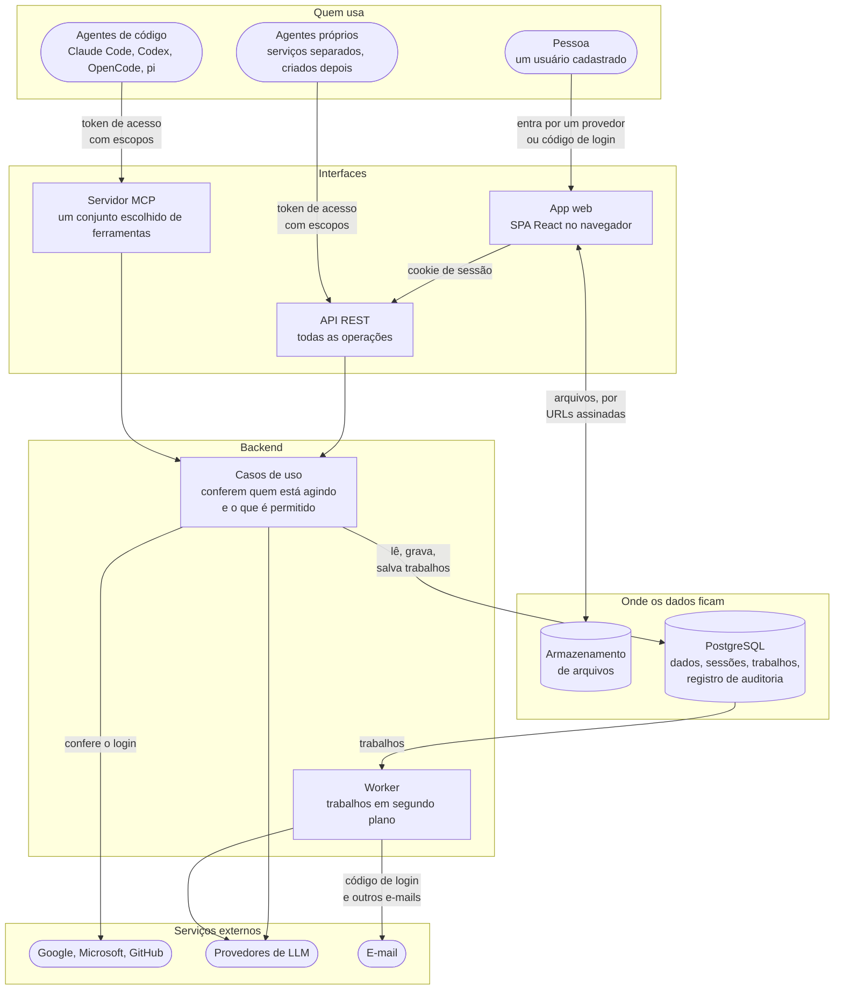
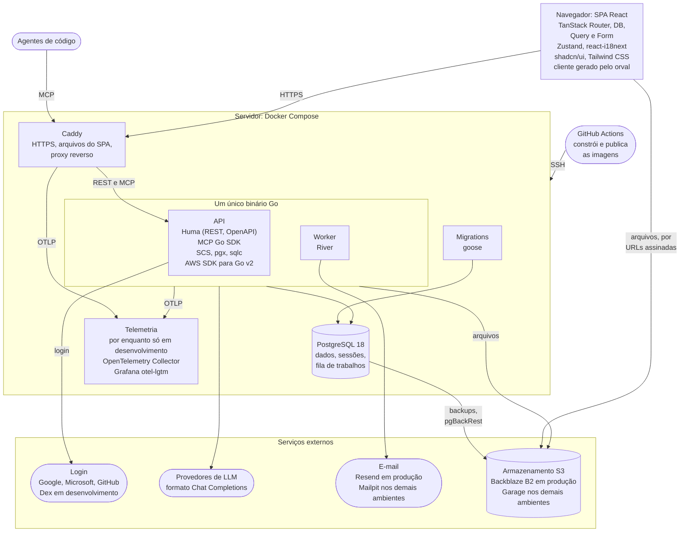

<!-- Versão em português. Mantenha este arquivo sincronizado com o README.md (versão principal). -->

[English](README.md) | **Português**

# My Software Factory Manager

Gerenciador de clientes e projetos: uma plataforma centralizada para gestão de clientes, projetos e demandas de desenvolvimento de software.

> **Status:** em fase de definição. Ainda não há código; as seções marcadas como _A definir_ serão preenchidas conforme o projeto avança.

## Sumário

- [Sobre o projeto](#sobre-o-projeto)
- [Arquitetura](#arquitetura)
- [Tecnologias](#tecnologias)
- [Build e deploy](#build-e-deploy)
- [Backup e manutenção](#backup-e-manutenção)
- [Documentação](#documentação)
- [Licença](#licença)

## Sobre o projeto

### Objetivo

O objetivo é criar uma plataforma centralizada para gestão de clientes, projetos e demandas de desenvolvimento de software, funcionando como o centro operacional de uma consultoria.

A ideia é ter um ambiente para administrar todo o ciclo de vida de um cliente e seus projetos, desde o primeiro contato e o levantamento de necessidades até a entrega, a validação e a manutenção das soluções.

Mais do que um simples gerenciador de tarefas, o sistema deve funcionar como uma espécie de escritório digital inteligente, organizando as informações, os documentos, a comunicação, as demandas e as atividades de cada projeto.

### Problema que resolve

_A definir._

<!-- Descreva a dor atual: onde as informações de clientes e projetos ficam hoje, o que se perde ou se duplica, e quem sofre com isso. -->

### Quem usa e como



Três tipos de consumidor chegam ao sistema, cada um pela sua interface:

- **Uma pessoa** usa o app web no navegador. Ela entra pelo Google, pela Microsoft ou pelo GitHub, ou com um código de login enviado por e-mail, e só entra quem é usuário cadastrado.
- **Agentes de código** usam o servidor MCP, que oferece um conjunto escolhido de ferramentas: atualizar o status de um projeto, consultar clientes e horas, buscar uma credencial.
- **Agentes próprios**, criados depois como serviços separados, usam a API REST.

Um agente entra com um token de acesso que um usuário criou para ele, limitado por escopos, e o que ele faz fica registrado como ação desse usuário. Todas as interfaces terminam nos mesmos casos de uso, que decidem se a ação é permitida, então as regras são as mesmas para qualquer consumidor.

Os dados são lidos e gravados no PostgreSQL. Os arquivos vão direto do navegador para o armazenamento e de volta, por URLs assinadas emitidas pela API. O que ninguém espera na tela é salvo como um trabalho e executado pelo worker: envio de e-mail, processamento de arquivos e chamadas a provedores de LLM.

Os tipos de usuário, e o que cada um pode fazer, ainda não foram modelados.

## Arquitetura

### Visão geral

Decidido até aqui (veja os ADRs abaixo):



O worker executa os trabalhos em segundo plano que a API grava no PostgreSQL: envio de e-mail, processamento de arquivos e chamadas a provedores de LLM que ninguém espera na tela. O navegador envia e baixa arquivos direto do armazenamento, com URLs assinadas emitidas pela API.

Em produção os arquivos ficam no Backblaze B2. Em desenvolvimento e na homologação ficam no Garage, atrás de um endereço do Caddy.

A telemetria passa pelo coletor: traces e métricas da API, do worker e do Caddy, a saída de todos os containers e as métricas do servidor, do PostgreSQL e do armazenamento. Ele repassa tudo ao Grafana otel-lgtm, que guarda por 30 dias e envia os alertas por e-mail. O Grafana tem um endereço próprio atrás do Caddy, com login pelo GitHub. Por enquanto os dois containers de telemetria rodam só em desenvolvimento: a produção passa a tê-los quando alguém além do mantenedor usar o sistema, e até lá um monitor hospedado fora do servidor a vigia.

O sistema roda em três ambientes: desenvolvimento na máquina do mantenedor, homologação (staging) em um servidor criado para um pull request e destruído depois, e produção em um servidor sempre ligado.

Frontend e backend ficam neste único repositório. As pastas ainda sem uso têm apenas um arquivo `.gitkeep`, e os arquivos de configuração da raiz entram junto com o primeiro código:

```
.
├── apps/
│   ├── api/          # backend e API em Go
│   ├── web/          # o app React real
│   └── prototype/    # protótipo clicável com dados falsos, descartável
├── packages/
│   └── ui/           # design system: variáveis de estilo e componentes
├── deploy/           # Caddyfile, arquivos Compose dos servidores, cloud-init
├── .github/          # workflows da pipeline
├── docs/
│   ├── adr/          # decisões de arquitetura
│   ├── agents/       # configuração para agentes de IA
│   └── design/       # análise das referências visuais
├── .scratch/         # issues locais
├── compose.yaml      # desenvolvimento
├── Taskfile.yml
└── pnpm-workspace.yaml
```

Os três pacotes JavaScript (`apps/web`, `apps/prototype`, `packages/ui`) formam um workspace pnpm executado pelo Vite+. Um Taskfile na raiz coordena as tarefas de Go e de frontend: desenvolvimento, build, testes e geração de código. Não é usado orquestrador de monorepo à parte.

As telas são desenhadas e aprovadas primeiro no protótipo e depois refeitas no app real, sobre o mesmo design system.

O sistema é multilíngue: inglês é a língua padrão, com suporte também a português do Brasil e espanhol, e cada usuário escolhe a sua. Adicionar uma língua é uma mudança pequena de código, sem alterar a estrutura do banco de dados.

<!-- Descreva a responsabilidade de cada componente e como eles se comunicam. Atualize o diagrama quando a arquitetura for confirmada. -->

### Decisões de arquitetura

As decisões relevantes e difíceis de reverter são registradas como ADRs (Architecture Decision Records) em `docs/adr/`, um arquivo por decisão. Este README traz apenas a visão geral e o índice abaixo.

- [0001 - Go no backend](docs/adr/0001-go-for-the-backend.md): Go em vez de TypeScript e Rust, porque agentes escrevem o código e o ciclo de build precisa ser curto
- [0002 - React como SPA, sem framework full-stack](docs/adr/0002-react-spa-without-a-full-stack-framework.md): Vite+ e TanStack Router atrás do Caddy, sem Next.js nem TanStack Start
- [0003 - Contrato OpenAPI gerado do Go](docs/adr/0003-openapi-contract-generated-from-go.md): os tipos Go são a fonte da verdade da API REST, via Huma
- [0004 - Provedores de LLM e agentes via HTTP](docs/adr/0004-llm-providers-and-agents-over-http.md): uma interface interna para os provedores; agentes são serviços separados que agem apenas pela API
- [0005 - Multilíngue desde o início](docs/adr/0005-multilingual-from-the-start.md): inglês, português do Brasil e espanhol; o front traduz os códigos de erro da API; conteúdo de configuração tem uma versão por língua, texto livre é traduzido sob demanda
- [0006 - Design system validado em um protótipo descartável](docs/adr/0006-design-system-proven-in-a-disposable-prototype.md): shadcn/ui em `packages/ui`, compartilhado pelo produto e por um protótipo clicável cujas telas aprovadas são refeitas, não movidas
- [0007 - Backend organizado por área de domínio](docs/adr/0007-backend-organized-by-domain-area.md): uma árvore de pacotes por área de domínio com dependências apontando para dentro, um caso de uso para cada operação, DDD tático seletivo e parte do object calisthenics
- [0008 - Casos de uso atendidos por vários adaptadores de entrada](docs/adr/0008-use-cases-served-by-several-inbound-adapters.md): uma API REST completa e um servidor MCP com um conjunto escolhido de ferramentas, ambos no backend Go; tokens de acesso com escopos; GraphQL, gRPC e WebSocket adiados
- [0009 - Convenções da API REST](docs/adr/0009-rest-api-conventions.md): snake_case, operações nomeadas sem PATCH, entrada estrita, erros em problem+json, paginação por cursor, sem versionamento enquanto todo consumidor sair junto com o backend
- [0010 - Identificadores sequenciais expostos via Sqids](docs/adr/0010-sequential-identifiers-exposed-through-sqids.md): inteiros por dentro, prefixo de tipo mais codificação Sqids por fora (`prj_Xk9fQ2mB`), com alfabetos fixos no código
- [0011 - Login por provedores externos ou por código de login](docs/adr/0011-login-through-external-providers-with-a-server-side-session.md): Google, Microsoft e GitHub, ou um código de seis dígitos enviado por e-mail; sessão no servidor atrás de um cookie opaco, apenas usuários cadastrados
- [0012 - OpenTelemetry e um registro de auditoria separado](docs/adr/0012-opentelemetry-for-observability-and-a-separate-audit-log.md): traces e métricas enviados por um coletor a um container Grafana, logs lidos da saída dos containers, alertas por e-mail; operações sensíveis gravadas em um registro de auditoria somente de acréscimo
- [0013 - Dados do frontend em coleções e consultas por cursor](docs/adr/0013-frontend-data-in-collections-and-cursor-queries.md): TanStack DB para conjuntos limitados, TanStack Query com o cursor da API para o resto, Zustand só para estado de interface, cliente e schemas Zod gerados pelo orval, TanStack Form
- [0014 - Frontend organizado por área de domínio](docs/adr/0014-frontend-organized-by-domain-area-and-tested-through-screens.md): uma pasta por área de domínio com um módulo de dados que é o único a chamar a API; os testes renderizam telas inteiras em um navegador real com a API simulada
- [0015 - SQL escrito à mão e verificado pelo sqlc, e migrations só para frente](docs/adr/0015-hand-written-sql-checked-by-sqlc-and-forward-only-migrations.md): pgx e sqlc, migrations do goose sem caminho de volta aplicadas em um passo próprio, três usuários do banco, PostgreSQL como único serviço de dados, sem cache e sem pool de conexões externo
- [0016 - Trabalhos em segundo plano no PostgreSQL, executados por um comando worker](docs/adr/0016-background-jobs-in-postgresql-run-by-a-worker-command.md): River, o trabalho gravado na transação do seu caso de uso, um comando `worker` do mesmo binário, poucas tentativas e depois uma falha visível
- [0017 - Arquivos no Garage, acessados direto pelo navegador](docs/adr/0017-files-in-garage-reached-directly-by-the-browser.md): Garage no lugar do MinIO, apenas a API S3 pelo AWS SDK para Go v2, uploads e downloads com URLs assinadas de curta duração
- [0018 - Valores de credenciais cifrados pela API](docs/adr/0018-credential-values-encrypted-by-the-api.md): AES-256-GCM no binário Go com uma chave vinda da configuração do deploy, nunca no banco; uma credencial em arquivo é guardada do mesmo modo
- [0019 - Três ambientes, com a homologação em um servidor criado sob demanda](docs/adr/0019-three-environments-with-staging-on-a-server-created-on-demand.md): desenvolvimento na máquina, um servidor de homologação criado para um pull request rotulado e populado pelo seed a cada publicação, produção em um servidor da Hetzner; o GitHub Actions publica por SSH, com os segredos nos Environments do GitHub
- [0020 - PostgreSQL com backup pelo pgBackRest, e arquivos de produção no Backblaze B2](docs/adr/0020-postgresql-backed-up-by-pgbackrest-and-production-files-in-backblaze-b2.md): backups contínuos e cifrados em outro provedor, com um teste mensal de restauração, e os arquivos de produção em um bucket com versionamento; o Garage continua em desenvolvimento e na homologação
- [0021 - Um repositório público sob a AGPLv3](docs/adr/0021-a-public-repository-under-agplv3.md): público no plano gratuito do GitHub, com as regras que isso impõe aos commits e à pipeline

## Tecnologias

| Tecnologia | Papel no projeto |
| --- | --- |
| [Go](https://go.dev/) | Backend e API |
| [Huma](https://huma.rocks/) | Framework HTTP que gera a especificação OpenAPI a partir dos tipos Go |
| [MCP Go SDK](https://github.com/modelcontextprotocol/go-sdk) | Servidor MCP dentro do backend, pelo qual agentes de código operam o sistema |
| [Sqids](https://sqids.org/go) | Identificadores públicos curtos, codificados a partir dos sequenciais internos |
| [SCS](https://github.com/alexedwards/scs) | Sessões no servidor, guardadas no PostgreSQL |
| [env](https://github.com/caarlos0/env) | Lê a configuração das variáveis de ambiente para uma única struct tipada |
| [pgx](https://github.com/jackc/pgx) | Driver do PostgreSQL e o pool de conexões dentro da API |
| [sqlc](https://sqlc.dev/) | Gera código Go tipado a partir de SQL escrito à mão |
| [goose](https://github.com/pressly/goose) | Aplica as migrations do banco, só para frente |
| [pgtestdb](https://github.com/peterldowns/pgtestdb) | Dá a cada teste de banco o seu próprio banco temporário |
| [River](https://riverqueue.com/) | Trabalhos em segundo plano guardados no PostgreSQL e executados pelo comando `worker`, com um painel web |
| [AWS SDK para Go v2](https://github.com/aws/aws-sdk-go-v2) | Cliente do armazenamento S3; assina as URLs de upload e download |
| [go-mail](https://github.com/wneessen/go-mail) | Envia e-mail por SMTP em desenvolvimento e nos testes |
| [Resend](https://resend.com/) | Envia os e-mails em produção e avisa das devoluções |
| [Mailpit](https://mailpit.axllent.org/) | Container que captura os e-mails enviados em desenvolvimento e nos testes |
| [OpenTelemetry](https://opentelemetry.io/) | Traces e métricas do backend |
| [OpenTelemetry Collector](https://opentelemetry.io/docs/collector/) | Container que reúne traces, métricas e logs de todos os serviços e do servidor |
| [Grafana otel-lgtm](https://grafana.com/docs/opentelemetry/docker-lgtm/) | Um container que guarda e mostra a telemetria e envia os alertas |
| [vacuum](https://quobix.com/vacuum/) e [oasdiff](https://github.com/oasdiff/oasdiff) | Lint das convenções da API e relatório de mudanças incompatíveis na especificação OpenAPI |
| [React](https://react.dev/) | Frontend web (single-page app) |
| [Vite+](https://viteplus.dev/) | Ferramentas do frontend em uma única CLI (`vp`): servidor de desenvolvimento e build (Vite, Rolldown), testes (Vitest), lint (Oxlint), formatação (Oxfmt), além do runtime Node.js e do gerenciador de pacotes |
| [TanStack Router](https://tanstack.com/router) | Roteamento tipado no cliente; filtros e paginação ficam na URL |
| [TanStack DB](https://tanstack.com/db) e [TanStack Query](https://tanstack.com/query) | Dados da API no navegador: coleções para conjuntos pequenos, consultas por cursor para o resto |
| [TanStack Form](https://tanstack.com/form) e [Zod](https://zod.dev/) | Formulários, validados com schemas gerados da especificação OpenAPI |
| [Zustand](https://github.com/pmndrs/zustand) | Estado de interface compartilhado entre telas (tema, painéis) |
| [orval](https://orval.dev/) | Gera o cliente TypeScript, os schemas Zod e respostas simuladas a partir da especificação OpenAPI |
| [React Compiler](https://react.dev/learn/react-compiler) | Memoização automática dos componentes no build |
| [Playwright](https://playwright.dev/) e [MSW](https://mswjs.io/) | Testes de tela em navegador real com a API simulada (pelo Vitest) e testes de ponta a ponta |
| [Knip](https://knip.dev/) | Encontra arquivos, exports e dependências sem uso |
| [Chrome DevTools MCP](https://github.com/ChromeDevTools/chrome-devtools-mcp) | Permite aos agentes de código investigar a performance em um Chrome real |
| [react-i18next](https://react.i18next.com/) | Traduções da interface (inglês, português do Brasil, espanhol) |
| [shadcn/ui](https://ui.shadcn.com/) | Base do design system: o código dos componentes é copiado para `packages/ui`, sobre os primitivos do [Base UI](https://base-ui.com/) |
| [Tailwind CSS](https://tailwindcss.com/) | Estilos e variáveis de estilo do design system (temas claro e escuro) |
| [PostgreSQL](https://www.postgresql.org/) | Banco de dados relacional (versão 18) e único serviço de dados |
| [Garage](https://garagehq.deuxfleurs.fr/) | Armazenamento de objetos compatível com S3 (documentos e arquivos) em desenvolvimento e na homologação |
| [Backblaze B2](https://www.backblaze.com/cloud-storage) | Armazenamento de objetos compatível com S3 em produção: os arquivos e os backups do banco |
| [pgBackRest](https://pgbackrest.org/) | Backup contínuo e cifrado do PostgreSQL, com restauração para um ponto no tempo |
| [Dex](https://dexidp.io/) | Container de identidade por trás do provedor de login local, em desenvolvimento e nos testes |
| [Hetzner Cloud](https://www.hetzner.com/cloud) | O servidor de produção e o servidor de homologação criado sob demanda |
| [GitHub Actions](https://docs.github.com/actions) | A pipeline: verificações em cada pull request, publicação e testes agendados |
| [GitHub CLI](https://cli.github.com/) | Como os agentes acessam o GitHub: pull requests, execuções e segredos |
| [Caddy](https://caddyserver.com/) | HTTPS, arquivos estáticos do frontend, proxy reverso para a API, cabeçalhos de segurança e o limite do código de login |
| [Docker](https://www.docker.com/) | Empacotamento e execução dos serviços em containers (Docker Compose) |
| [Task](https://taskfile.dev/) | Executor de tarefas do repositório (desenvolvimento, build, testes, geração de código) |
| [pnpm](https://pnpm.io/) | Gerenciador de pacotes do frontend, instalado e executado pelo Vite+ |

<!-- Inclua novas tecnologias nesta tabela à medida que forem adotadas. -->

## Build e deploy

### Pré-requisitos

| Ferramenta | Versão mínima |
| --- | --- |
| Docker | _A definir_ |
| Go | _A definir_ |
| Vite+ (gerencia Node.js e pnpm) | _A definir_ |
| Task | _A definir_ |
| GitHub CLI | _A definir_ |

### Configuração

_A definir._

<!-- Liste as variáveis de ambiente (conexão com o PostgreSQL, credenciais e bucket do armazenamento, servidor de e-mail etc.) e mantenha um `.env.example` versionado, sem segredos reais. -->

### Ambiente de desenvolvimento

_A definir._

<!-- Comandos para subir o ambiente local do zero: clonar, configurar, iniciar os serviços e acessar a aplicação. -->

### Build

_A definir._

<!-- Como gerar os artefatos de produção: binário do backend, bundle do frontend, imagens Docker. -->

### Deploy

Toda mudança chega à `main` por um pull request, e um merge na `main` é publicado em produção assim que a pipeline passa. O GitHub Actions constrói as imagens, envia para o registro de containers do GitHub e entra no servidor por SSH para baixá-las e reiniciar os serviços do Compose. Os segredos de cada ambiente ficam nos Environments do GitHub, e a publicação os grava em um arquivo de variáveis no servidor (veja o [ADR-0019](docs/adr/0019-three-environments-with-staging-on-a-server-created-on-demand.md)).

Para ver uma branch antes do merge, dê ao pull request dela o rótulo `staging`. Um servidor é criado com a branch, um banco novo e os dados do seed. Ele é destruído quando o rótulo sai ou o pull request fecha, e nunca vive mais de 24 horas.

Voltar a uma versão anterior é um workflow manual que publica um commit anterior da `main`.

Um deploy reinicia a única instância da API. A API termina as requisições em andamento antes de sair (veja Shutdown em [`CODING_STANDARDS.md`](CODING_STANDARDS.md)), então o arquivo do Compose dá a ela um `stop_grace_period` de 30 segundos, e o Caddy segura as requisições novas por até 30 segundos (`lb_try_duration`) até a nova instância aceitar conexões.

Antes de a API subir, um serviço de execução única do Compose aplica as migrations pendentes do banco, e a API só sobe se ele terminar bem. Quando há migration pendente, o deploy gera um `pg_dump` antes, porque as migrations não têm caminho de volta (veja o [ADR-0015](docs/adr/0015-hand-written-sql-checked-by-sqlc-and-forward-only-migrations.md)).

O worker é um segundo serviço da mesma imagem, iniciado com o comando `worker`. Em um deploy ele para de pegar trabalhos e dá tempo para os que estão rodando terminarem. Um trabalho interrompido roda de novo depois (veja o [ADR-0016](docs/adr/0016-background-jobs-in-postgresql-run-by-a-worker-command.md)).

Os comandos estão _A definir_ e serão escritos com o primeiro código.

## Backup e manutenção

### Backup

| O quê | Como | Frequência | Retenção |
| --- | --- | --- | --- |
| Banco de dados (PostgreSQL) | pgBackRest, cifrado, em um bucket no Backblaze B2 | WAL continuamente, um backup diferencial por dia e um completo por semana | 30 dias, com restauração para qualquer momento |
| Banco de dados, antes de uma migration | `pg_dump` gerado pela publicação, guardado no servidor | Cada publicação com migration pendente | Os três últimos |
| Arquivos (Backblaze B2) | Versionamento de objetos no bucket de produção | A cada mudança | Uma versão antiga por 30 dias |

Os backups ficam em um provedor diferente do servidor. A chave que cifra os valores das credenciais e a senha dos backups nunca são guardadas junto com eles: são segredos do Environment do GitHub, com uma cópia no gerenciador de senhas do mantenedor. Um monitor fora do servidor avisa quando um backup não dá sinal (veja o [ADR-0020](docs/adr/0020-postgresql-backed-up-by-pgbackrest-and-production-files-in-backblaze-b2.md)).

### Restauração

Todo mês um workflow agendado cria um servidor, restaura nele o último backup, confere o resultado e destrói o servidor.

O passo a passo para restaurar à mão está _A definir_ e será escrito com a rotina de backup.

<!-- Passo a passo para restaurar o banco e os arquivos a partir de um backup. -->

### Manutenção

- **Dependências.** `task outdated` lista o que tem versão mais nova. Um workflow semanal roda esse comando e mantém a lista em uma única issue no GitHub, que avisa quem mantém o sistema; ele não abre pull request. `task outdated:machine`, rodado à mão, faz o mesmo para as ferramentas instaladas na máquina de quem mantém. Cada atualização é um pull request próprio (veja Versions em [`CODING_STANDARDS.md`](CODING_STANDARDS.md)).
- **Vulnerabilidades.** Um workflow semanal roda govulncheck, `pnpm audit` e Trivy nas imagens.
- **Logs.** Em produção, a saída dos containers é lida no servidor.

O restante está _A definir._

<!-- Rotinas recorrentes ainda por descrever: rotação de credenciais, atualização dos servidores. -->

## Documentação

- `docs/adr/`: decisões de arquitetura (ADRs).
- `GLOSSARY.md`: glossário dos termos do domínio.
- [`CODING_STANDARDS.md`](CODING_STANDARDS.md): como o código é escrito, para os agentes e para a revisão.
- [`docs/providers.md`](docs/providers.md): os serviços externos de que o sistema depende, com o motivo, o custo e o que está configurado em cada um.
- [`docs/design/`](docs/design/): análise das referências visuais que embasam o design system.
- [`docs/agents/`](docs/agents/): configuração usada pelos agentes de IA neste repositório.

`docs/adr/` e `GLOSSARY.md` são criados conforme o domínio e a arquitetura forem definidos.

## Licença

[GNU Affero General Public License, versão 3](LICENSE). Veja o [ADR-0021](docs/adr/0021-a-public-repository-under-agplv3.md).
